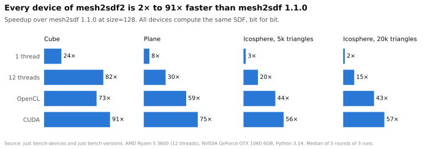
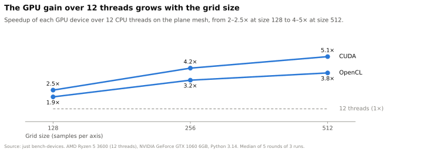

[](https://pepy.tech/project/mesh2sdf2) [](https://pepy.tech/project/mesh2sdf2/month) [](https://pypi.org/project/mesh2sdf2/)

# mesh2sdf2

Repository: <https://github.com/LuckJMG/mesh2sdf2>. Maintainer: Lucas Mosquera.

mesh2sdf2 is a community-maintained fork of [mesh2sdf](https://github.com/wang-ps/mesh2sdf) by Peng-Shuai Wang. The fork keeps the algorithm and the public API of the original project, so the import name is still `mesh2sdf`.

## Project description

With mesh2sdf2 you can convert a triangle mesh to a signed distance field (SDF) on a regular grid. The library also works with **non-watertight** meshes, such as the meshes of ShapeNet, since it repairs the surface before it computes the sign.

Compared with the original project, mesh2sdf2 supports Python 3.10 to 3.14, builds with current versions of setuptools and pybind11, and computes the SDF about 28 times faster on a 12-thread CPU.


## Who this project is for

This project is for researchers and developers who need signed distance fields from 3D meshes, for example to generate training data for 3D deep learning. The original mesh2sdf generated the training data of the paper [Dual Octree Graph Networks (SIGGRAPH 2022)](https://wang-ps.github.io/dualocnn).

## Project dependencies

Before you use mesh2sdf2, make sure that you have:

- Python 3.10 or later.
- A C++ compiler that [pybind11 supports](https://github.com/pybind/pybind11#supported-compilers), if no wheel exists for your platform or you install from source.

pip installs the Python dependencies (NumPy, trimesh, and scikit-image) automatically.

## Instructions for using mesh2sdf2

Get started with mesh2sdf2 by installing it from PyPI.

### Install mesh2sdf2

1. Install the package from PyPI.

    ```shell
    pip install mesh2sdf2
    ```

2. Alternatively, install it from the source code.

    ```shell
    git clone https://github.com/LuckJMG/mesh2sdf2.git
    cd mesh2sdf2
    pip install .
    ```

### Run mesh2sdf2

1. Scale the vertices of your mesh to the range `[-1, 1]` and call `mesh2sdf.compute`.

    ```python
    import trimesh
    import mesh2sdf

    mesh = trimesh.creation.icosphere(radius=0.8)
    size = 128
    sdf = mesh2sdf.compute(mesh.vertices, mesh.faces, size, fix=True, level=2 / size)
    print(sdf.shape)  # (128, 128, 128)
    ```

2. To process the example mesh of the repository, run the demo script from the repository root.

    ```shell
    python example/demo.py
    ```

    The script writes `example/data/plane.fixed.obj` with the repaired mesh and `example/data/plane.npy` with the SDF. To process another mesh, pass its path, for example `python example/demo.py path/to/mesh.obj`.

The signature of the function is `mesh2sdf.compute(vertices, faces, size=128, fix=False, level=0.015, return_mesh=False, device="cpu")`.

| Parameter | Description |
|---|---|
| `vertices` | Array of shape `(N, 3)`. The values must be in the range `[-1, 1]`. |
| `faces` | Array of shape `(M, 3)` with the vertex indices of each triangle. |
| `size` | Resolution of the grid. The grid has `size` samples per axis and spans `[-1, 1]`, both ends included. |
| `fix` | If `True`, repairs the mesh before it computes the sign. Use it for non-watertight meshes. |
| `level` | Level-set value for the repair. The recommended value is `2 / size`. |
| `return_mesh` | If `True`, also returns the repaired mesh as a `trimesh.Trimesh`. |
| `device` | `"cpu"` (default), `"cuda"` for NVIDIA GPUs, or `"opencl"` for any OpenCL device, such as AMD, Intel, or NVIDIA GPUs. The result is identical to the CPU result, bit for bit. |

The function returns a `float32` array of shape `(size, size, size)`.

### Troubleshoot mesh2sdf2

| Issue | Solution |
|---|---|
| The SDF has wrong values and no error appears. | Scale the vertices to the range `[-1, 1]`, since the function does not check the range. |
| The sign of the SDF is wrong on an open mesh. | Call `compute` with `fix=True`. |
| `compute` raises `ValueError`. | Use a `size` of 2 or more. |
| `pip install` fails while it builds the extension. | Install a C++ compiler that pybind11 supports. |
| `compute` with `device="cuda"` raises `ImportError`. | Install the GPU extra with `pip install mesh2sdf2[gpu]`. It requires an NVIDIA GPU and CUDA 12. |
| `compute` with `device="opencl"` raises `ImportError`. | Install the OpenCL extra with `pip install mesh2sdf2[opencl]`, and the OpenCL driver of your GPU. |
| `compute` with `device="opencl"` uses the wrong device, or raises `RuntimeError`. | Set the `PYOPENCL_CTX` environment variable to the device to use, for example `PYOPENCL_CTX=0`. The device must support correctly rounded division and square root. |

## Performance

Every device of mesh2sdf2 computes the SDF **2x to 91x faster** than the original mesh2sdf 1.1.0, and all devices compute the same SDF, bit for bit. The next chart compares the four devices on four meshes with `size=128`, on an AMD Ryzen 5 3600 with 12 threads and an NVIDIA GeForce GTX 1060 6GB. Each time is the median of 3 runs in a new process with Python 3.14. The 12-thread times vary by about 15% from one round of runs to the next, so each time of 12 threads and of the GPU paths is the median of 5 rounds.

<picture>
  <source media="(prefers-color-scheme: dark)" srcset="https://raw.githubusercontent.com/LuckJMG/mesh2sdf2/main/docs/img/speedup-dark.svg">
  
</picture>

The gain depends on the mesh as well as on the device. On the cube, 12 threads are faster than OpenCL, and on the icosphere with 20k triangles, OpenCL is almost 3 times faster than 12 threads. The size of the grid also changes the gain, so the next chart compares how each GPU path scales against 12 threads on the plane, at three sizes.

<picture>
  <source media="(prefers-color-scheme: dark)" srcset="https://raw.githubusercontent.com/LuckJMG/mesh2sdf2/main/docs/img/grid-size-dark.svg">
  
</picture>

At size 128, every device computes the SDF in less than one second. At size 512, the time goes from 41 s on one thread to 2.2 s with CUDA, so a GPU saves the most time on large grids. For this reason, choose the device by your hardware and your workload:

- `device="cpu"` (the default) with all threads, for a machine without a GPU or for grids of about `size=128`.
- `device="cpu"` with `OMP_NUM_THREADS=1`, for many meshes at the same time, with one mesh per Python thread or process, since the C++ core releases the GIL.
- `device="opencl"`, for a GPU of any vendor with an OpenCL driver, such as AMD, Intel, or NVIDIA.
- `device="cuda"`, for an NVIDIA GPU with CUDA 12.

The sweep in 2.4.0 skips a row of the grid when no row that it reads changed since the last sweep that read it, since a check on an unchanged row cannot lower any distance. For this reason, the SDF of 2.4.0 is identical to the SDF of 2.3.0, bit for bit.

The C++ core releases the Python global interpreter lock (GIL), so several Python threads can call `compute` at the same time. With `OMP_NUM_THREADS=1`, four Python threads that each process the cube finish 85x faster than with the original project, from 24.1 s to 0.28 s. The release of the GIL gives 4x of that gain. In 2.2.0, the sweep took almost all the time, so the parallel sign, memcpy, and parallel init steps gave no measurable gain on these meshes.

To reproduce the numbers, run `just bench-versions`. The run takes about 30 minutes, and the speedup depends on the number of CPU cores. To reproduce the numbers of the charts, run `just bench-devices`, which takes about 15 minutes. The script `docs/plots.py` draws the charts from these numbers.

## How it works

1. mesh2sdf2 computes the **unsigned** distance field with the fast sweeping algorithm of [SDFGen](https://github.com/christopherbatty/SDFGen) by Christopher Batty. This step is accurate even for non-watertight meshes, since the unsigned distance does not depend on the inside or the outside of the surface.
2. If `fix=True`, the marching cubes algorithm extracts the level set at the small value `level`. The result is a manifold triangle mesh.
3. The extracted mesh can have several connected components, so mesh2sdf2 keeps the component with the largest bounding box.
4. mesh2sdf2 computes the signed distance field again on the kept mesh and returns it as the final output.

## Contributing guidelines

To report a bug or propose a change, open an issue or a pull request in the [GitHub repository](https://github.com/LuckJMG/mesh2sdf2).

## Additional documentation

For more information:

- [Original mesh2sdf repository](https://github.com/wang-ps/mesh2sdf), with the paper and the algorithm.
- [Dual Octree Graph Networks](https://wang-ps.github.io/dualocnn), the project page of the paper that uses mesh2sdf.
- [SDFGen](https://github.com/christopherbatty/SDFGen), the source of the fast sweeping algorithm.

## How to get help

- [GitHub issues](https://github.com/LuckJMG/mesh2sdf2/issues), for bugs and questions about the fork.

## Citation

If you use the code in your research, please cite the paper of the original authors.

```bibtex
@article {Wang-Sig2022,
  title      = {Dual Octree Graph Networks for Learning Adaptive Volumetric
                Shape Representations},
  author     = {Wang, Peng-Shuai and Liu, Yang and Tong, Xin},
  journal    = {ACM Transactions on Graphics (SIGGRAPH)},
  volume     = {41},
  number     = {4},
  year       = {2022},
}
```

## Terms of use

mesh2sdf2 is licensed under the MIT License. See [LICENSE](LICENSE).
